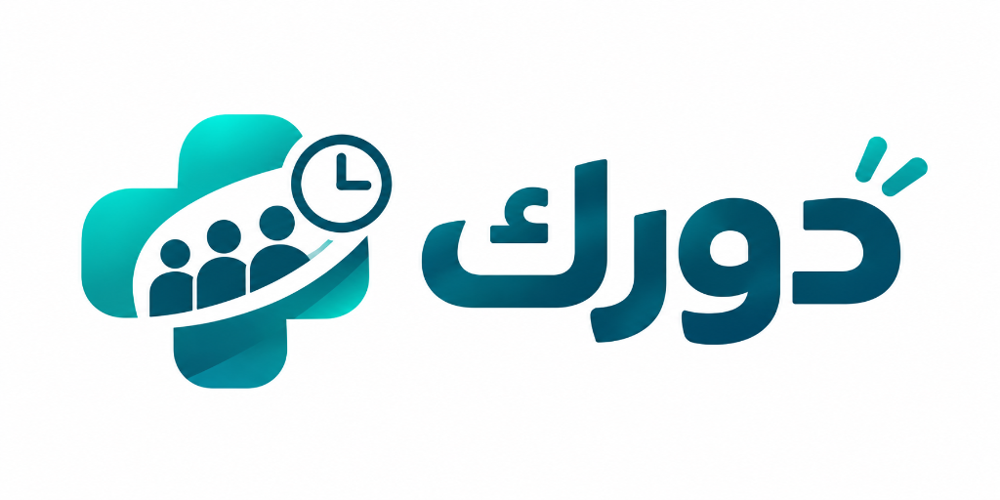

# Dawrak (دورك) - B2B SaaS Clinic Queue Management System



**Dawrak (دورك)** is a modern, high-throughput B2B SaaS Clinic Queue Management System built strictly for medical polyclinics and specialized practices. It eliminates waiting room chaos with instant QR check-in, real-time WebSocket digital ticketing, atomic zero-race-condition queue numbers, and automated wait time estimation.

---

## 🌟 Core Highlights

- **⚡ Zero Race Conditions**: Atomic queue sequence number generation via MongoDB `$inc` on daily `QueueCounter`.
- **🔄 Live WebSocket Sync**: Real-time push updates for reception staff, doctors, and patient digital tickets (powered by Socket.io).
- **📱 Zero-Install Patient Check-in**: Patients scan reception QR codes to view live sequential turn numbers and dynamic wait time.
- **🛡️ Multi-Tenant Architecture**:
  1. **Super Admin Dashboard (`/super-admin`)**: Clinic registrations, doctor quota limits, manual InstaPay/Vodafone Cash subscription approvals.
  2. **Clinic Staff Portal (`/clinic/[clinicId]`)**: Live queue actions (Call, In-Session, Complete, Next), doctor roster with quota enforcement, printable desk QR generator.
  3. **Patient Mobile App (`/q/[clinicId]`)**: Real-time ticket updates with audio cue & vibration notifications upon turn arrival.
- **🎨 Minimalist Medical Design System**: Strict medical-tech flat palette:
  - Primary Dark: `#123B4A`
  - Secondary Teal: `#176B68`
  - Accent Mint: `#36B8A4`
  - Background Light: `#E8F5F2`
  - Surface White: `#F7FAFC`

---

## 🛠️ Tech Stack

- **Framework**: Next.js 16 (App Router), React 19, TypeScript
- **Styling**: Tailwind CSS v4, PostCSS
- **Database & ODM**: MongoDB Atlas, Mongoose
- **Real-Time Engine**: Socket.io + Node HTTP Server
- **Icons & QR**: Lucide React, `qrcode.react`
- **Auth & Support**: NextAuth.js, WhatsApp Web Integration (`+201010428244`)

---

## 🚀 Getting Started

### 1. Clone the repository
```bash
git clone https://github.com/aloll0/Dawark.git
cd Dawark
```

### 2. Install dependencies
```bash
npm install
```

### 3. Environment Variables
Copy `.env.example` to `.env.local` and configure your credentials:
```env
MONGODB_URI=mongodb+srv://<username>:<password>@cluster.mongodb.net/dawrak?retryWrites=true&w=majority
NEXTAUTH_SECRET=your-secret-key
NEXTAUTH_URL=http://localhost:3000
NEXT_PUBLIC_APP_URL=http://localhost:3000
NEXT_PUBLIC_WHATSAPP_SUPPORT=+201010428244
```

### 4. Run Development Server
```bash
npm run dev
```

The application will start on [http://localhost:3000](http://localhost:3000).

---

## 📂 Project Structure

```
Dawrak/
├── public/                 # Static assets & Dawrak logo
├── src/
│   ├── app/
│   │   ├── api/            # REST API endpoints (clinics, doctors, queue, seed)
│   │   ├── clinic/         # Clinic staff queue management
│   │   ├── q/              # Patient QR check-in & digital ticket
│   │   ├── super-admin/    # Super admin platform controls
│   │   ├── layout.tsx      # Root layout & navbar
│   │   └── page.tsx        # Landing & tenant navigator
│   ├── components/         # Reusable UI components
│   ├── hooks/              # Socket.io connection hook
│   ├── lib/                # MongoDB & atomic queue service
│   └── models/             # Mongoose schemas (Clinic, Doctor, PatientTicket, QueueCounter)
├── server.js               # Custom Node HTTP server bridging Next.js & Socket.io
└── package.json
```

---

## 📄 License
MIT License. Built for modern medical clinics.
